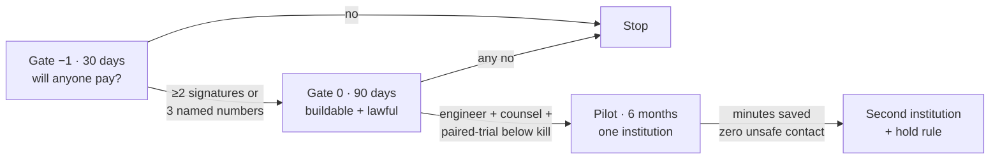

# Roadmap

Public roadmap. Gates are honest: the default at every gate is **stop**.

## Now — Gate −1: willingness to pay (weeks 0–4)

- [x] Adversarial assessment ([`docs/00-assessment.md`](docs/00-assessment.md))
- [x] Three independent reviews, and what changed ([`docs/04-review-log.md`](docs/04-review-log.md))
- [x] Threat model and safety invariants ([`docs/03-threat-model-and-safety.md`](docs/03-threat-model-and-safety.md))
- [x] Event protocol v0.1 for comment ([`docs/spec/duress-event-v0.1.md`](docs/spec/duress-event-v0.1.md))
- [ ] Ten meetings: 4 tier-1, 4 MMO/PSP, 2 insurers — one ask, pass/fail recorded
- [ ] Anonymised complaint-file requests to three institutions (a refusal is a finding)
- [ ] Scoped counsel memo commissioned
- [ ] Neutral public handle; this record published with its review log

**Gate −1:** ≥2 pilot signatures, **or** ≥3 named figures from named budget holders with cycle dates. Otherwise stop.

## Next — Gate 0: buildable and lawful (weeks 4–16)

- [ ] Staging-replica paired-trial experiment, pre-registered kill at >20% detection
- [ ] Bank mobile-auth **and** notification-service engineer confirm the band-scoped path in writing
- [ ] Counsel names at least one power under which a receiving institution may act
- [ ] 3 trauma-informed practitioner conversations; safeguarding sign-off on the interaction
- [ ] One institution names a sponsor **and** an engineer

**Gate 0:** all three of engineer ✓, counsel ✓, paired-trial below threshold ✓. Otherwise stop, or pivot to the accountability-only product.

## Then — Single institution (months 4–10)

- [ ] One integration, one corridor, capped value, staff-supervised
- [ ] DPIA signed; DPA executed; retention with destructive delete at closure; DSAR path tested
- [ ] Independent penetration test; safeguarding sign-off; breach runbook rehearsed
- [ ] Pre-registered metrics with a pre-launch baseline

**Gate 1:** measured minutes-to-notice · zero unsafe-contact incidents · a case where the institution acted (hold **or** fast referral) inside the window. A held-funds case is not required — the hold rule does not exist yet.

## Later — Second institution and the hold rule (months 10–18)

- [ ] Second institution on a different core/auth stack
- [ ] Corridor-level hold agreement with defined liability
- [ ] Engagement with NIBSS on a duress reason code (not a new network)
- [ ] Safety review board seated with a real veto

## Eventually — Industry (months 15–24)

- [ ] Rail-level reason code or endorsed standard field
- [ ] Protocol v1.0 with compatibility policy
- [ ] Two reference deployments and a published safety report
- [ ] Regulator engagement anchored in a real deployment, not a pitch

## Explicitly not on the roadmap

Escrow · automatic reversal · public beneficiary blacklist · AI coercion detection · ambient recording · GPS risk scoring · cross-border · ATM/POS in MVP · a consumer-facing app as the core product.

Removing anything from this list requires a public RFC and safety sign-off.
