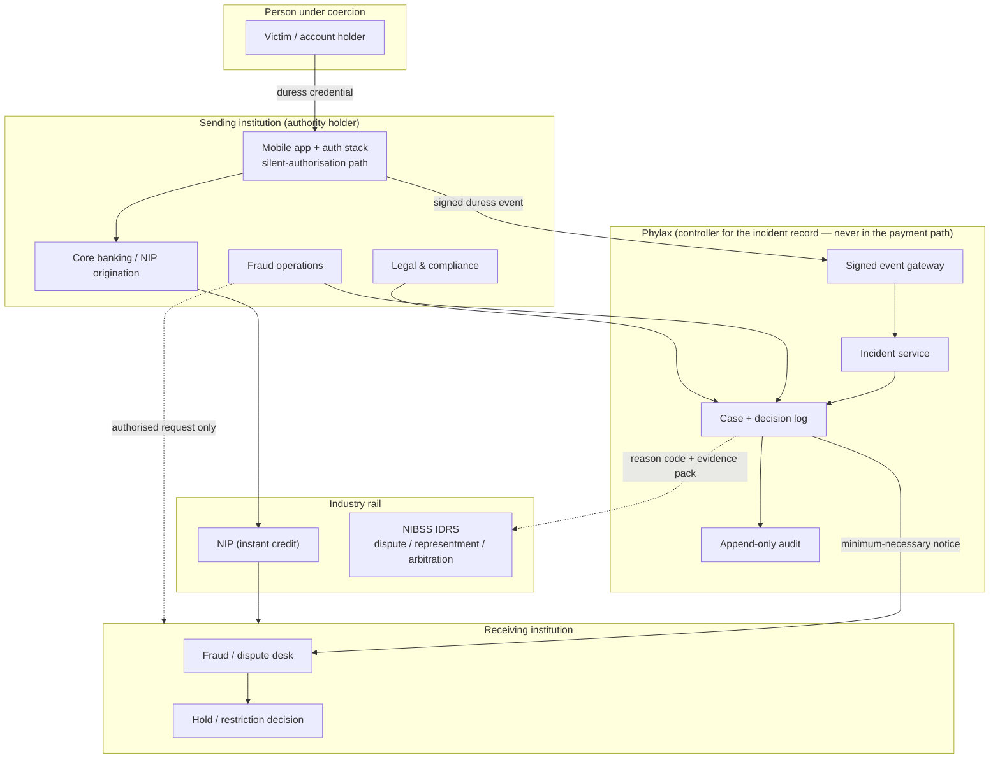
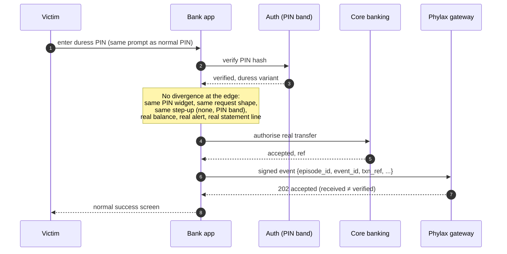
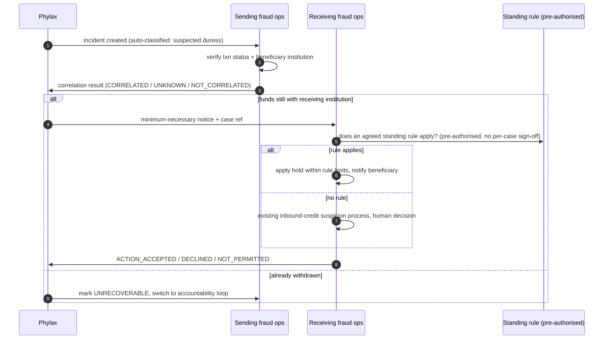
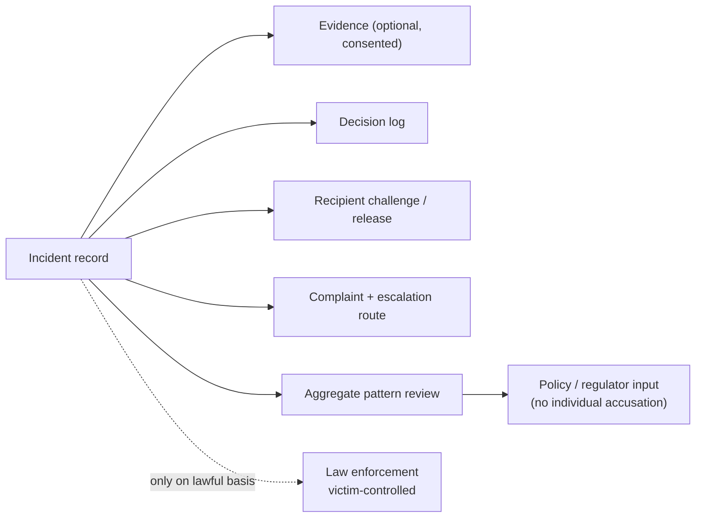
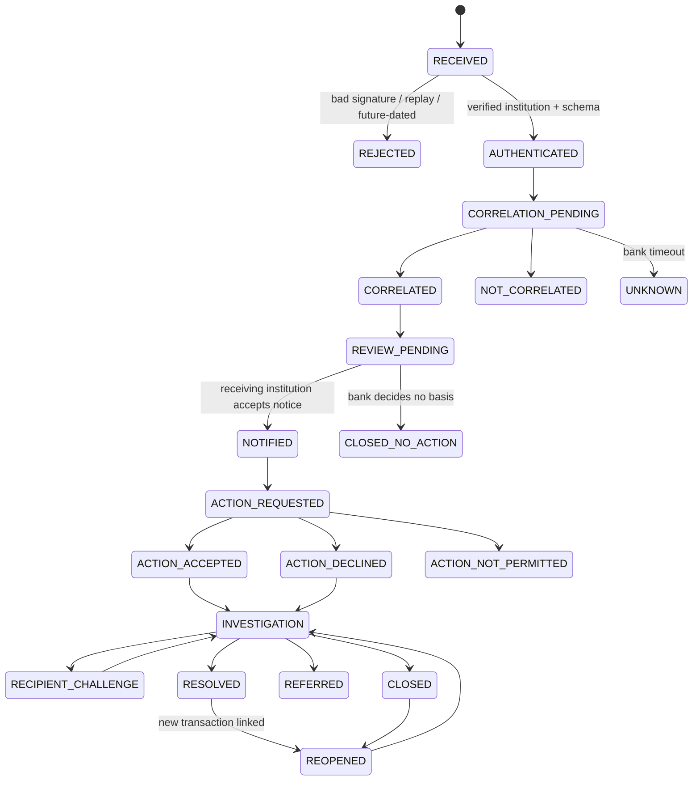
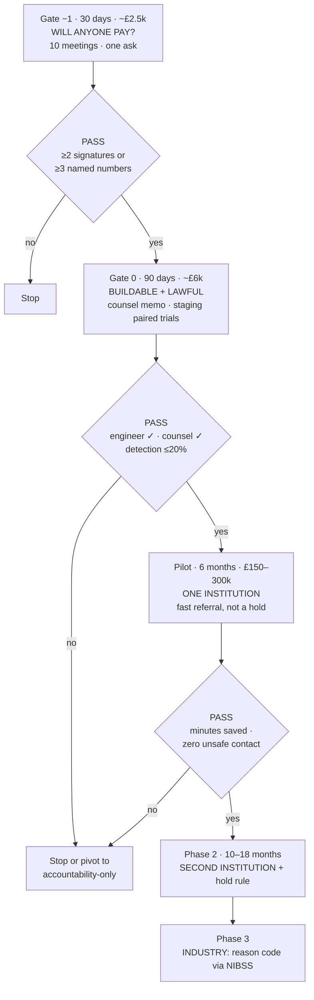

# 01 — Master flow

The system in one sentence: **a bank-native silent signal tags a live transfer, a bounded hold control buys minutes, and an auditable incident record handles everything that happens after the money moves.**

Three loops, in order of importance:

1. **Signal loop** (seconds) — inside the bank. Decides whether this transfer is flagged.
2. **Preservation loop** (minutes) — across institutions. Decides whether money can be stopped.
3. **Accountability loop** (hours to weeks) — evidence, decisions, complaints, patterns.

The playbook v1.0 built loop 3 and called it the product. Loops 1 and 2 are where the value is.

---

## 1. System context

**Trust boundary:** Phylax sits *outside* the payment path. A Phylax outage must never delay a transfer. That property is load-bearing and must be testable.

---

## 2. Loop 1 — Signal (target: < 2 s, inside the bank)

**Why the band matters.** In a PIN-only value band the duress request and a normal request are byte-identical at the edge. There is no step-up exemption to log, nothing to suppress, and no lie in the balance. Above that band, step-up exists — and a bypass flag, or an OTP that fails to arrive, is itself the tell. The duress feature therefore cannot cover the highest-value transfers, which is a real, published limitation, not an implementation detail.

**Invariants**
- I1: within the configured band, a duress transfer produces the **same observable channels** as a normal transfer — same request shape, same step-up (none), same SMS/push alert, same balance movement, same statement line. Nothing is hidden except the control-plane notice.
- I2: no duress-specific UI, copy, haptic or timing exists at any point before, during or after the transfer.
- I3: the event is queued durably *before* the receipt renders; delivery may lag, the transfer may not.
- I4: the app never displays "help is on the way".
- I4a: **enrolment** is threat-modelled too — set-up artefacts must not be discoverable by someone who inspects the device, and rotation is available without an in-app "safety" menu.

**Open design questions (must be closed with a bank auth engineer + notification owner):**
- What band is PIN-only today, and does it include the transactions most likely to be coerced?
- Does the alert service fire identically for the duress variant? (Test on the bank's staging replica, not a simulator.)
- How is the duress PIN rotated after a coercer has watched it used, without a discoverable flow?
- Shared device, rooted device, borrowed phone: what is the honest behaviour?

---

## 3. Loop 2 — Preservation (target: < 10 min, cross-institution)

**Status: unproven and possibly impossible on NIP.** A pre-credit hold requires a standing rule negotiated with the receiving institution (and likely NIBSS), not software. Until that exists, Phase 1 delivers a **fast referral**: a human at the receiving institution acts under its existing inbound-credit suspicion powers.

**The hard truth:** "funds still with receiving institution" is usually false after ~15 minutes. This loop is only credible if institutions agree a **standing hold rule** for flagged corridors — a negotiated control with a named legal power (lien or set-off, PND instruction, a CPRegs 2022 basis, or an injunction), a value cap, a duration cap, and an allocated liability. That negotiation is the commercial work. Software alone cannot buy minutes it does not have.

**Invariants**
- I5: no action originates from Phylax. Every state change cites an institutional authority reference.
- I6: a hold cites a **pre-authorised standing rule or a named legal power** — never a per-case opinion manufactured under time pressure, and never "the platform said so".
- I7: the receiving institution's own customer (the recipient) has a challenge path — but its **notification is deferred and silent** where disclosing it could endanger the sender. Victim safety outranks notice.
- I7a: a hold is observably visible to the beneficiary. Assume the coercer learns of it within the hold window, and design the rule duration accordingly.

---

## 4. Loop 3 — Accountability (hours to weeks)

**Invariants**
- I8: no **discretionary** law-enforcement referral. Statutory reporting (STR to the NFIU under MLPPA 2022, Cybercrimes Act duties) is non-discretionary, is **disclosed to the customer at enrolment**, and is not presented as a feature of the product.
- I9: aggregates never resolve to an identifiable beneficiary outside a case.
- I10: every export requires role + reason and is itself an audited event.
- I11: at case closure, duress status is deleted or irreversibly anonymised unless a named statutory obligation requires retention.

---

## 5. Incident state machine (normative)

Rules: every transition is idempotent on `(incident_id, transition, idempotency_key)`; `UNKNOWN` is a first-class state, never coerced into a decision; terminal states never auto-close while a linked transaction is `PENDING`.

**Episodes, not incidents, are the unit of a coercion.** One incident may span many events; one episode may span many incidents (a re-report after the victim is safe, a later transfer forced in the same detention). `episode_id` is carried on the envelope and is what prevents a six-transfer coercion from becoming six unrelated cases. Cross-episode pattern detection is a review signal, never an automatic escalation.

---

## 6. Build sequence (what exists, when)

Each gate has explicit, pre-registered kill criteria in `02-master-plan.md`. The default at every gate is **no**.

---

## 7. What the public sees vs what stays private

| Public (repo) | Private (held back) |
|---|---|
| Problem definition and boundaries | Victim interview notes, identities, verbatim accounts |
| Safety principles and threat model | Pilot institution identities and internal procedures |
| Event protocol v0.1 + state machine | Hold-rule negotiation positions and legal opinions |
| Assessment, kill criteria, and the review log | Commercial terms, pricing, pipeline |
| Roadmap and governance | Adversarial test results with exploitable detail |
| Source register | Bank-specific auth internals |

Rule: **publish anything a regulator, a bank's CISO, or a hostile journalist could safely read.** Withhold anything that could endanger a participant, expose a bank's controls, or hand an attacker a working map.
